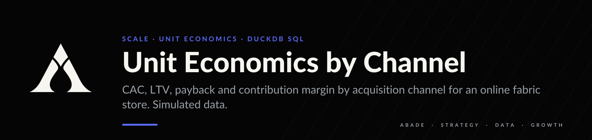
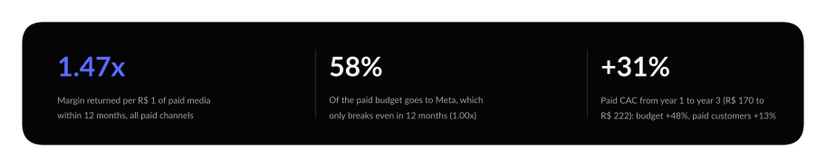
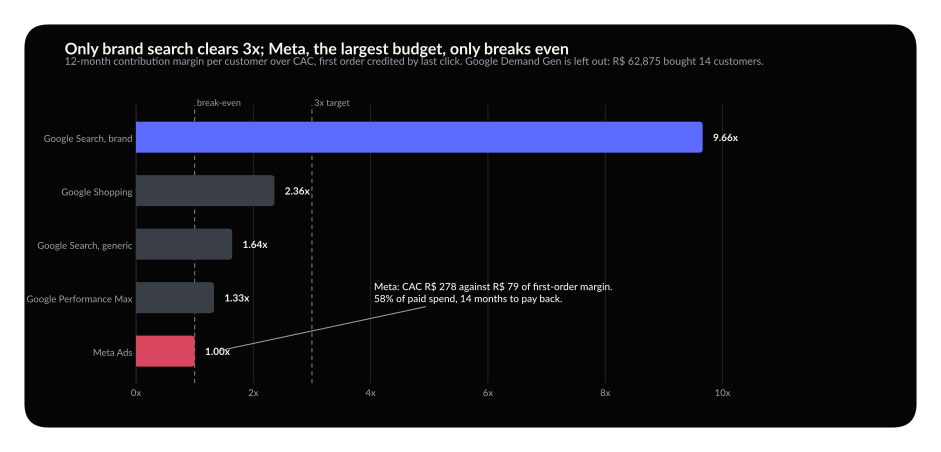
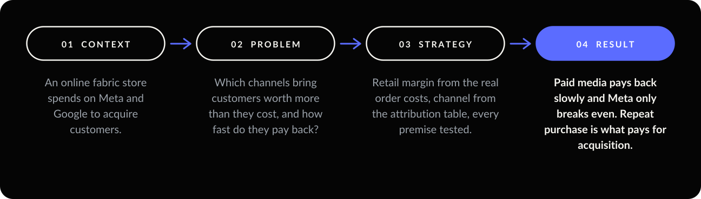
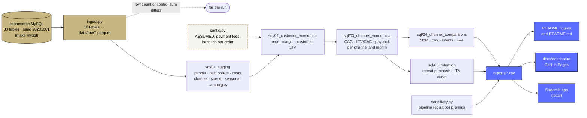
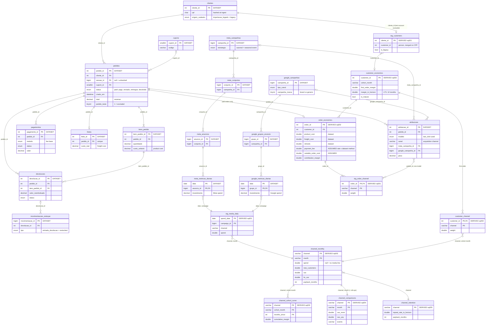
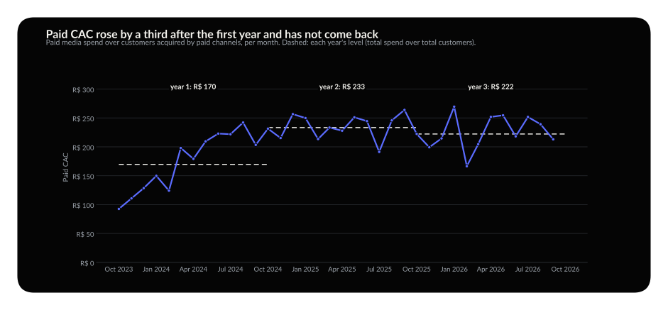
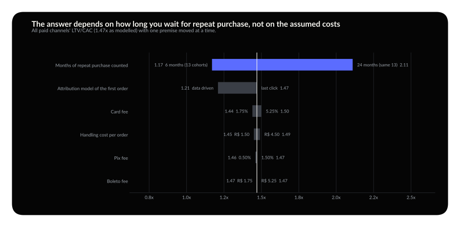
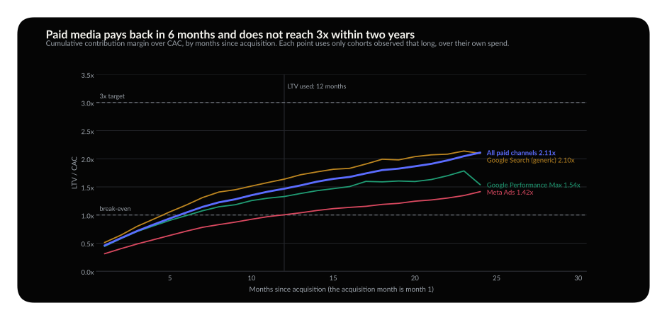
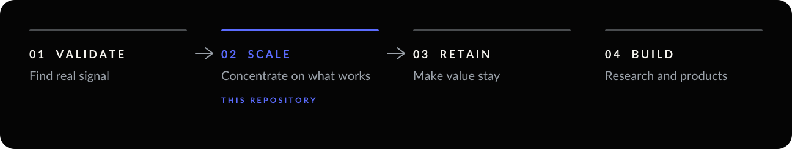

<!-- Generated by `python -m unit_economics.readme` from templates/README.template.md and reports/. Edit the template, not this file. -->
<p align="center"></p>

<p align="center">
  
  
  
  
  <a href="https://arielabade.github.io/unit-economics-olist/dashboard/"></a>
</p>

**Every R$ 1 spent on paid media comes back as 1.47x of contribution margin within 12 months, and it
takes 6 months to get there.** The first order of a paid customer leaves R$ 86.18 of
margin against a R$ 208.86 CAC: acquisition is paid for by repeat purchase, and Meta, with 58% of the
budget, only breaks even (1.00x).

> **Data are simulated.** Tecelã Tecidos is a fictitious online fabric store. Its database was generated from
> the workings of a real e-commerce and describes no real company. See [docs/DATA_SOURCE.md](docs/DATA_SOURCE.md).

**[Open the client dashboard →](https://arielabade.github.io/unit-economics-olist/dashboard/)** · static, no server, readable on a phone.

<p align="center"></p>

<p align="center"></p>

> **Decision.** Settle the payback the business can wait for before touching the budget, test Meta's real
> effect instead of cutting it on last click, cap CAC per channel at the ceiling below, and put the next real
> into repeat purchase.

<details>
<summary><b>What is in this repository</b></summary>

| | |
| --- | --- |
| **The question** | Which acquisition channels bring customers worth more than they cost, and how fast do they pay back, in a store that keeps the whole sale and pays for the goods? |
| **The data** | The `ecommerce` repository: a simulated online fabric store, 131,759 paid orders in 36 months. Channel and media spend **come from the dataset**; only two costs are assumed. |
| **The method** | DuckDB SQL over the store's own costs, with every assumption in one file and every premise stress-tested. |
| **The output** | CAC, LTV, payback and a CAC ceiling per channel and month, a client dashboard on GitHub Pages, and the premise the answer depends on. |

```
sql/        staging → customer economics → channel economics → comparisons → retention
src/        ingest, pipeline, metric formulas, roll-up, sensitivity, reports, figures, dashboard, README
tests/      formulas, the SQL on a hand-built copy of the source, ingest checks, the anti-circularity guard
reports/    committed result tables: the only source of the figures, the dashboard and this README
docs/       DATA_SOURCE.md and the static dashboard (GitHub Pages)
app/        Streamlit dashboard (local, adjustable)
```

</details>

<p align="center"></p>

---

## 01 — Context

An online fabric store sells to hobbyists, seamstresses, ateliers and small clothing makers, and spends on Meta
and Google to acquire customers. It is a **retailer, not a marketplace**: it keeps the whole sale and pays for the
goods, so the economics are built on revenue minus the real cost of serving each order.

### Data

| | |
| --- | --- |
| Source | `ecommerce` repository (Tecelã Tecidos), MySQL 8.4, 33 tables, read-only |
| Generator | deterministic, seed `20231001`, scale `1.0` |
| Window | 2023-10 to 2026-09 (36 complete months) |
| Size | 131,759 paid orders · 44,532 new customers · R$ 38.24M revenue · R$ 4.24M media spend |

| From the dataset | ASSUMED (`config.py`) | SIMULATED by this project |
| --- | --- | --- |
| Orders, revenue, discounts, freight charged | Payment fee: Pix 1.0%, card 3.5%, boleto R$ 3.50 | **Nothing** |
| Product cost per item, real freight cost | Packaging and service: R$ 3.00 per order | |
| Refunds and restocked returns | | |
| Acquisition channel (attribution table) | | |
| Daily media spend, Meta and Google | | |

The earlier version of this project ran on the Olist marketplace dataset, which has no channel and no spend, so
both were simulated. With this dataset **the hash-based channel and the spend-as-share-of-revenue rule are
gone**: channel and spend are read. [docs/DATA_SOURCE.md](docs/DATA_SOURCE.md) maps every table, its grain, which
field feeds which number, and what is missing.

`python -m unit_economics.ingest` checks every table against the generator's row counts and control sums of
the money columns, so a different seed or a half-loaded database fails loudly. It reconciles with the source's
own dbt marts to the cent.

---

## 02 — Problem

Not *which channel brings the most customers*, but *which channel brings customers worth more than they cost,
and how long until they pay back*. That needs a margin model built on real costs, a channel per customer, and
spend next to the customers it bought.

---

## 03 — Strategy

| Decision | Why |
| --- | --- |
| **Margin on the sale minus real costs** | A retailer pays for the goods and the carrier. Product cost, freight, refunds and restocks come from the dataset; only payment fees and handling are assumed. |
| **Channel = attribution of the first paid order (last click)** | The rule the source's own `dim_clientes` mart uses. Google Search is split into brand and generic, because brand search mostly harvests people already looking for the store. |
| **People, not accounts** | Accounts with the same CPF are one person; legacy customers imported from the old platform are never "acquired". |
| **Spend is read, never derived** | Spend comes from the platforms. A test adds customers acquired by Meta and checks that Meta's spend does not move: CAC can never collapse into an input. |
| **Undefined stays undefined** | A channel with no media line has no CAC, not a CAC of zero. |
| **Rates are ratios of sums** | Total spend over total customers, so a quiet month does not weigh as much as Black Friday. |
| **LTV only for cohorts observed for the whole horizon** | A cohort acquired last month has not had time to come back. |
| **Every premise stress-tested** | The pipeline is rebuilt with each premise moved, and the answer is reported with the one it depends on. |

### The pipeline



Gold: data from the `ecommerce` dataset. Dashed: assumptions. Blue: outputs. Nothing in the pipeline is
simulated.

### The data model

Source tables keep their Portuguese names from `ecommerce/schema.sql`; derived tables are English. Each entity
says where it comes from, and the only two assumed values are marked `ASSUMED`.



### Metrics

```
contribution_margin = revenue                 products - discount + freight charged
                    - product_cost            quantity x unit cost
                    - freight_cost            what the carrier charged
                    - refunds + restocked_cost
                    - payment_fee             ASSUMED rate x amount paid, by method
                    - variable_order_cost     ASSUMED, per order
CAC                 = channel spend / new customers of the channel
LTV                 = contribution margin of the customer's first 12 months
LTV/CAC             = LTV / CAC, on the same mature cohorts
payback             = months of cumulative margin until it covers CAC (acquisition month = 1)
CAC ceiling at Nx   = LTV / N
```

---

## 04 — Result

**Across 36 months the store sold R$ 38.24M, kept R$ 16.38M of contribution margin
(42.8%) and spent R$ 4.24M on media, leaving R$ 12.14M.** It acquired 44,532 new
customers at a blended R$ 95.11; 20,278 (46%) were credited to paid media at
R$ 208.86 each.

| Channel | Spend | New customers | CAC | CAC / first-order margin | LTV (12 m) | LTV/CAC | Payback | Bought again in 12 m |
| --- | ---: | ---: | ---: | ---: | ---: | ---: | --- | ---: |
| Meta Ads | R$ 2,468,830 | 8,871 | R$ 278 | 352% | R$ 266 | 1.00x | 14 months | 56% |
| Organic search | no media line | 7,043 | undefined | — | R$ 300 | — | — | 59% |
| Untracked | no media line | 6,529 | undefined | — | R$ 340 | — | — | 59% |
| Organic social | no media line | 4,631 | undefined | — | R$ 283 | — | — | 57% |
| Direct | no media line | 4,416 | undefined | — | R$ 310 | — | — | 58% |
| Google Search, brand | R$ 136,634 | 4,140 | R$ 33 | 38% | R$ 302 | 9.66x | 1 month | 58% |
| Google Performance Max | R$ 778,868 | 3,214 | R$ 242 | 256% | R$ 324 | 1.33x | 7 months | 58% |
| Google Search, generic | R$ 643,623 | 3,070 | R$ 210 | 215% | R$ 329 | 1.64x | 5 months | 61% |
| Google Shopping | R$ 144,429 | 969 | R$ 149 | 187% | R$ 352 | 2.36x | 3 months | 58% |
| Referral | no media line | 942 | undefined | — | R$ 320 | — | — | 58% |
| WhatsApp | no media line | 578 | undefined | — | R$ 326 | — | — | 55% |
| E-mail | no media line | 115 | undefined | — | R$ 437 | — | — | 74% |
| Google Demand Gen *(small sample)* | R$ 62,875 | 14 | R$ 4,491 | 5617% | R$ 482 | 0.11x | not within the window | 43% |
| **All paid channels** | R$ 4,235,259 | 20,278 | R$ 209 | 242% | R$ 297 | 1.47x | 6 months | 58% |
| **Whole store** | R$ 4,235,259 | 44,532 | R$ 95 | 108% | R$ 305 | 3.27x | — | 58% |

Unpaid channels show no CAC: they have no media line, and a CAC of zero would make them the best channel in every
table. E-mail acquires almost nobody (115) but closes 5,804 orders: it is a repeat
channel, not an acquisition one. *Untracked* are first orders with no session (ad blockers, WhatsApp sales),
15% of new customers; some of them came from ads, so per-channel paid CAC is if anything
overstated, while the blended CAC does not depend on it.

**The CAC ceiling.** Only brand search sits under the 3x ceiling, and brand search mostly collects people who
were already looking for the store:

| Paid channel | CAC | Ceiling to break even (12-month LTV) | Ceiling at 3x | Clears 3x? |
| --- | ---: | ---: | ---: | --- |
| Google Search, brand | R$ 33 | R$ 302 | R$ 101 | yes |
| Google Shopping | R$ 149 | R$ 352 | R$ 117 | no |
| Google Search, generic | R$ 210 | R$ 329 | R$ 110 | no |
| Google Performance Max | R$ 242 | R$ 324 | R$ 108 | no |
| Meta Ads | R$ 278 | R$ 266 | R$ 89 | no |

Google Demand Gen is left out of the charts: R$ 62,875 bought 14 customers.

**Paid CAC rose and has not come back.** The paid budget grew 48% from year 1 to year 3 while
customers from paid media grew 13%; store revenue grew 76%, carried by
repeat purchase.

| | Paid spend | Customers from paid media | Paid CAC | Store revenue |
| --- | ---: | ---: | ---: | ---: |
| Year 1 (2023-10 to 2024-09) | R$ 1.10M | 6,506 | R$ 170 | R$ 9.31M |
| Year 2 (2024-10 to 2025-09) | R$ 1.50M | 6,431 | R$ 233 | R$ 12.53M |
| Year 3 (2025-10 to 2026-09) | R$ 1.63M | 7,341 | R$ 222 | R$ 16.40M |

<p align="center"></p>

Year 1 starts with the database, when a larger share of buyers is new, so part of its lower CAC is a start-up
effect. Months with fewer than 30 new customers in a channel are flagged on the dashboard instead
of read as a trend, and every month carries the store's own seasonal campaigns (Black Friday, Christmas, Festa
Junina, Mother's Day, back to school).

**Customers come back at the same rate whatever brought them.** 40% buy again within 90 days and
58% within 12 months; across paid channels the 12-month rate only ranges from 56% to
61%. Channels differ in what a customer costs, not in what a customer is worth.

**Meta: 58% of the paid budget, 352% of the first-order margin.** Meta's CAC is
R$ 278.30 against R$ 79.11 of first-order margin; it takes 14 months to pay back
and returns 1.00x in 12. But last click undercounts it: during the documented pause of Meta
prospecting (2025-08-04 to 2025-08-24) the store's new customers fell 34% from July to August, against
4% over the same months of 2024. Customers credited to Meta fell by 174; those of every
other channel by 313 (by 12 a year earlier), mostly brand search, organic search and
untracked. One month is a signal, not a proof.

**Free shipping is a cost.** The store paid the carriers R$ 950k more than it charged its customers,
2.5% of revenue.

---

## 05 — Sensitivity and limits

**The answer depends on how many months of repeat purchase you count, not on the assumed costs.** Each premise
was moved on its own and the whole pipeline rebuilt:

| Premise | Low | High | All paid channels' LTV/CAC | Swing |
| --- | --- | --- | --- | ---: |
| Months of repeat purchase counted in LTV | 6 months | 24 months | 1.04x to 2.11x | 1.07 |
| Attribution model of the first order | data driven | last click | 1.21x to 1.47x | 0.26 |
| Card fee | 1.75% | 5.25% | 1.44x to 1.50x | 0.06 |
| Handling cost per order | R$ 1.50 | R$ 4.50 | 1.45x to 1.49x | 0.04 |
| Pix fee | 0.50% | 1.50% | 1.46x to 1.47x | 0.01 |
| Boleto fee | R$ 1.75 | R$ 5.25 | 1.47x to 1.47x | 0.00 |

<p align="center"></p>

<p align="center"></p>

The 24-month value uses the cohorts observed that long, which were acquired more cheaply. Holding those
13 cohorts still, LTV/CAC goes from 1.65x at 12 months to 2.11x at 24: the horizon itself,
not the cohort mix, moves the answer.

- **CAC is average, not incremental.** It is the cost per customer the attribution table credits, not the cost
  of a customer who would not have come otherwise. The Meta pause is the closest thing to an experiment in the
  data; a geo-split holdout is the next step. See
  [marketing-mix-modeling](https://github.com/arielabade/marketing-mix-modeling) and
  [ab-testing-toolkit](https://github.com/arielabade/ab-testing-toolkit).
- **Margin is before sales taxes**, which the dataset does not record, and leaves out influencer, CRM, agency and
  content costs: channels without a media line have an undefined CAC, never an invented one.
- **LTV is observed, not predicted**: only cohorts with 12 complete months carry one. Predicting it for younger
  cohorts is the job of [clv-cohort-prediction](https://github.com/arielabade/clv-cohort-prediction).
- **The data are simulated.** The framework is the deliverable; the numbers describe a fictitious store.

---

## Dashboard

**https://arielabade.github.io/unit-economics-olist/dashboard/** — executive summary, months, channels, unit economics and CAC ceiling, sensitivity and
recommendation, in Portuguese for the client, with method details in a collapsible block. It is a static page
built by `python -m unit_economics.dashboard` from the same `reports/` as this README. The Streamlit app is the
local version, with the target LTV/CAC adjustable.

## Run it

```bash
# 1. the source: in the ecommerce repository (sibling folder), per its own README
make ambiente && make dados && make mysql

# 2. this project
git clone https://github.com/arielabade/unit-economics-olist
cd unit-economics-olist
python -m venv .venv && source .venv/bin/activate
pip install -e ".[dev,ingest]"

python -m unit_economics.ingest      # reads the ecommerce MySQL, checks row counts and control sums
python -m unit_economics.pipeline    # builds the analysis, writes data/processed/
pytest                               # 62 tests, none of which needs the database
python -m unit_economics.reports     # rewrites reports/ (includes the sensitivity rebuilds, ~1 min)
python -m unit_economics.figures     # README charts from reports/
python -m unit_economics.dashboard   # docs/dashboard/index.html from reports/
python -m unit_economics.readme      # this README from reports/
streamlit run app/streamlit_app.py   # local dashboard
```

The ecommerce repository is expected at `../ecommerce`; set `ECOMMERCE_DIR` otherwise, and
`ECOMMERCE_MYSQL_*` to override its connection. `--source csv` reads its CSV exports instead of MySQL.

## Repository map

```
sql/          01 staging · 02 customer economics · 03 channel economics · 04 comparisons · 05 retention
src/          ingest, pipeline, metrics, summary, sensitivity, reports, figures, dashboard, readme
tests/        formulas, SQL on hand-built source tables, ingest, sensitivity, README consistency
reports/      committed result tables
docs/         DATA_SOURCE.md, dashboard/ (GitHub Pages)
templates/    README.template.md
app/          Streamlit dashboard
data/         raw/ and processed/, both git-ignored
```

---

<p align="center"></p>

<p align="center">
  <a href="https://github.com/arielabade">Portfolio</a> &nbsp;·&nbsp;
  <a href="https://github.com/arielabade/clv-cohort-prediction">Next: predict what customers are worth →</a>
</p>
